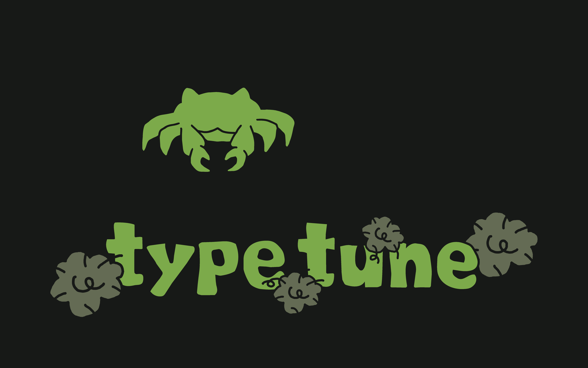
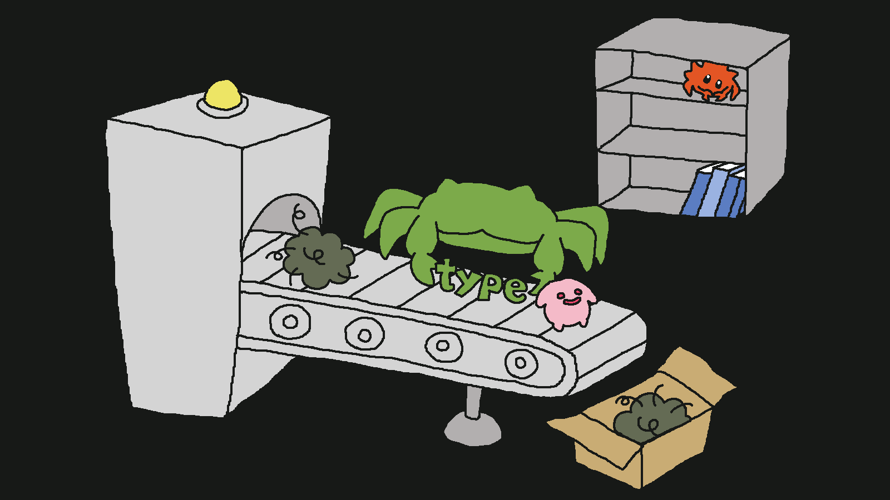

# type-tune

<p align="center">
  
</p>

<p align="center">
  <a href="https://github.com/necoz-oss/type-tune/actions/workflows/test.yml"></a>
  <a href="https://github.com/necoz-oss/type-tune/actions/workflows/docs.yml"></a>
  <a href="LICENSE"></a>
  
</p>

<h3 align="center">Give shared TypeScript types a better home. 😸</h3>
<p align="center">Scan. Review. Move. Validate.</p>

**type-tune** is a Rust-powered CLI that finds shared TypeScript `type` aliases and `interface` declarations and helps move them without manually chasing imports.

It creates a reviewable plan, updates supported type imports and re-exports, and validates the rewrite with TypeScript. **You decide what moves and where.**

> **Pre-release:** The npm packages are not published yet. Commands using `npx` below describe the intended workflow. To try it now, [build from source](#development).

## Why type-tune?

Types often start next to a component or utility, then end up shared across a project. Moving them later means tracking imports, local dependencies, and barrels by hand.

- **Discover** shared types with deterministic candidate IDs.
- **Review** `plan.md` and choose the destination before making changes.
- **Rewrite** supported type-only imports, aliases, and simple barrels while keeping compatibility re-exports at the original module path.
- **Validate** with `tsc`, with rollback after normal validation failures and dry-run previews.
- **Optionally** add AI review notes without letting AI control the rewrite.

Unlike [Knip](https://knip.dev/), which finds unused code, type-tune focuses on **moving types that are still in use**. The tools are complementary.

<p align="center">
  
</p>

## Quick Start

Start with a clean Git working tree.

```bash
# 1. Find candidates
npx type-tune scan --project tsconfig.json

# 2. Generate a reviewable plan
npx type-tune plan --project tsconfig.json \
  --out .type-tune/plan.json \
  --markdown .type-tune/plan.md

# 3. Review the plan (or edit plan.md manually)
npx type-tune review --markdown .type-tune/plan.md

# 4. Preview, then apply
npx type-tune apply --plan .type-tune/plan.json \
  --markdown .type-tune/plan.md --dry-run
npx type-tune apply --plan .type-tune/plan.json \
  --markdown .type-tune/plan.md
```

Candidates begin as `[ignore]`. Mark only the ones you want as `[apply]`. You can also change the `to:` path in `plan.md` to select a **new, project-relative destination**:

```md
- [apply] <candidate-id> `OrderSummary`
  - kind: `typeAlias`
  - from: `src/features/order/schema.ts`
  - to: `src/domains/orders/types/order-summary.ts`
```

Keep every candidate in the plan. Candidates from the same source must share a destination. Do not edit the original candidate metadata in `plan.json`.

## A small example

Before, a type lives beside a feature:

```ts
// src/features/order/OrderPage.tsx
export type OrderSummary = {
  id: string;
  total: number;
};
```

After reviewing the move, the type can live in its own file:

```ts
// src/features/order/types/order.ts
export type OrderSummary = {
  id: string;
  total: number;
};
```

The original module keeps a type-only compatibility re-export, and supported TypeScript referrers are updated:

```ts
// src/features/order/OrderPage.tsx
export type { OrderSummary } from "./types/order";
```

That helps preserve imports through the original module, including unscanned consumers, but does not replace their own typechecks or builds.

## Installation

After the first npm release:

```bash
npx type-tune scan --project tsconfig.json
# or
pnpm add -D type-tune
```

The npm launcher requires **Node.js 22+** and selects the platform-specific Rust binary. Planned targets are macOS arm64/x64, Linux x64 GNU/musl, and Windows x64, subject to release verification.

## Scope & safety

- **TypeScript first:** scan and rewrite inspect `.ts` and `.tsx` files from the selected `tsconfig.json`. Vue, Svelte, Astro, JavaScript, and external consumers are not counted as referrers or rewritten. Run their own checks afterward.
- **Validation:** apply uses `tsc --noEmit --project`. It is not a Vue-aware or full-framework validation gate.
- **Safe review:** plans are revalidated against source changes and destination restrictions. Dry-run temporarily writes files, then restores them on normal completion. Forced termination and concurrent edits are not covered by that guarantee.
- **Limited moves:** exported type aliases and interfaces only; `enum`, `class`, default exports, namespace merges, and advanced value-derived types are outside the current scope.
- **Conservative formatting:** local conventions are preserved where safely possible, but formatter-clean output is not guaranteed. Review the diff and run your formatter.
- **Explicit scope:** existing `types/` directories and `types.ts` modules are excluded by default; monorepo traversal is not automatic.

For supported options and more detailed limitations, see [Requirements](docs/requirements.md).

## More commands

```bash
# Understand why a declaration is excluded
npx type-tune scan --project tsconfig.json --explain

# Include declarations already in types locations
npx type-tune scan --project tsconfig.json --include-existing-types

# Move one declaration directly (with preview)
npx type-tune extract OrderSummary \
  --from src/features/order/OrderPage.tsx \
  --to src/features/order/types/order.ts \
  --project tsconfig.json --dry-run

# Preview optional AI review data before sending it to a provider
npx type-tune plan --project tsconfig.json --ai-review --ai-dry-run
```

AI review is opt-in and only annotates the plan. See [AI review design](docs/ai-review-design.md) for provider configuration and data handling.

## Development

Build and use the CLI from source before npm publication:

```bash
pnpm install
pnpm build
target/release/type-tune --help
```

Run the main checks with `pnpm check`, and run the documentation checks with `pnpm docs:check && pnpm docs:build`.

## Documentation

- [Architecture](docs/design.md) · [Requirements](docs/requirements.md)
- [AI review](docs/ai-review-design.md) · [Release guide](RELEASING.md)
- [Distribution](docs/rust-migration.md) · [Development status](docs/development-plan.md)

<p align="center">
  
</p>

<p align="center"><strong>Small. Simple. Useful. Built Together! 🐈</strong></p>
